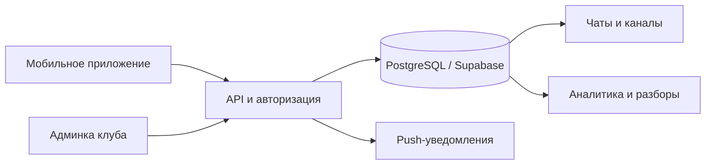
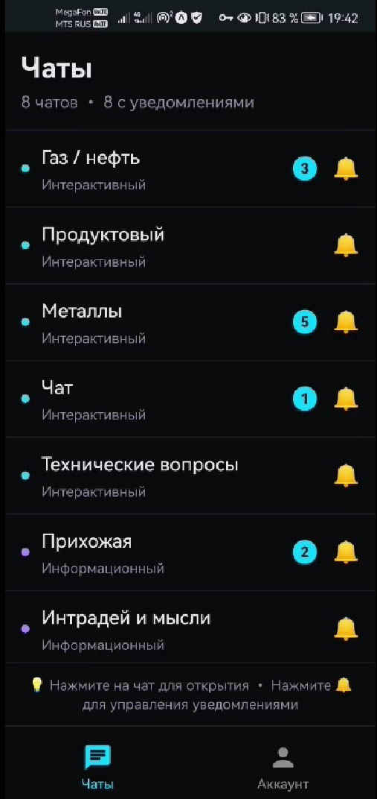

# RTrader App — MVP мобильного приложения для закрытого сообщества

> Клуб в кармане: тематические чаты, авторская аналитика и видео-разборы в одном приложении, независимом от Telegram.

[Раздел на сайте](https://www.traders-reflections.ru/#app) · [Портфолио](https://www.traders-reflections.ru)

## О проекте

RTrader App — мобильное приложение для закрытого сообщества трейдеров МосБиржи. Идея простая: у клуба должна быть своя площадка, а не арендованная лента в Telegram.

Приложение проектировалось как MVP: проверить, что участникам удобно общаться по инструментам, получать уведомления и возвращаться в клуб каждый день.

## Задача

Закрытому сообществу нужны:

- структурированные чаты по инструментам, а не одна общая лента;
- уведомления, которые не теряются;
- аналитика, разборы и обучающие материалы в одном месте;
- независимость от блокировок и сбоев внешних мессенджеров;
- управление доступами и контентом со стороны клуба.

## Решение

- **8 каналов:** 5 интерактивных и 3 информационных.
- **Интерактивные чаты:** газ, нефть, продуктовый, металлы; общий чат и техническая поддержка.
- **Информационные каналы:** прихожая, интрадей и мысли, видео-разборы.
- **Уведомления** по всем каналам.
- **Личный кабинет** участника: профиль, подписка, настройки.
- **Админка:** каналы, пользователи, доступы, контент.

## Как устроено

## Технологии

`React Native` · `Expo` · `TypeScript` · `Supabase` · `PostgreSQL` · push-уведомления · REST API

## Статус

Открытое бета-тестирование. MVP собран, основные сценарии клуба проверены: чаты, уведомления, профиль, доступы.

## Скриншоты

## Почему без кода

В репозитории нет исходного кода и экспортов базы: в проекте есть данные участников клуба, переписка и внутренние настройки. Публикация кода потребовала бы ручной вычистки истории и персональных данных.

В репозитории — описание продукта, архитектура, интерфейс и ссылки. Кодовая база и данные остаются приватными.

## Ссылки

- [Раздел приложения на сайте](https://www.traders-reflections.ru/#app)
- [Портфолио](https://www.traders-reflections.ru)

## Лицензия

Все права защищены. Материалы опубликованы для демонстрации в портфолио.

## Контакты

Telegram: [@Rhodes_4ever](https://t.me/Rhodes_4ever) · Почта: [demetra68@gmail.com](mailto:demetra68@gmail.com)
